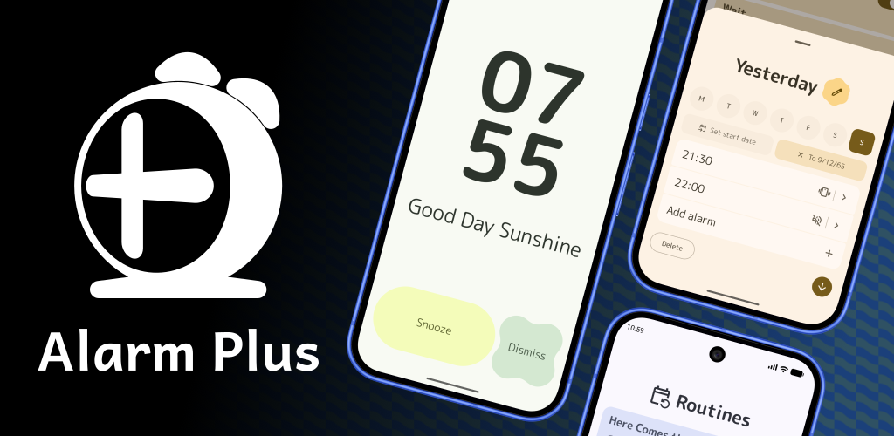
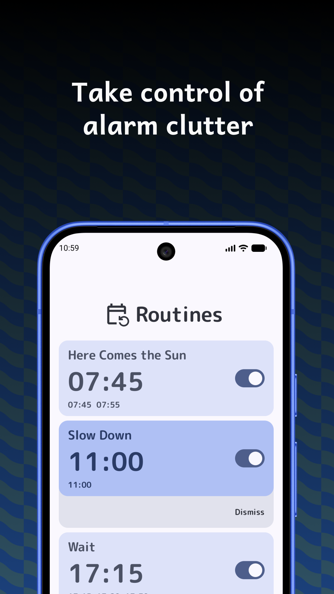
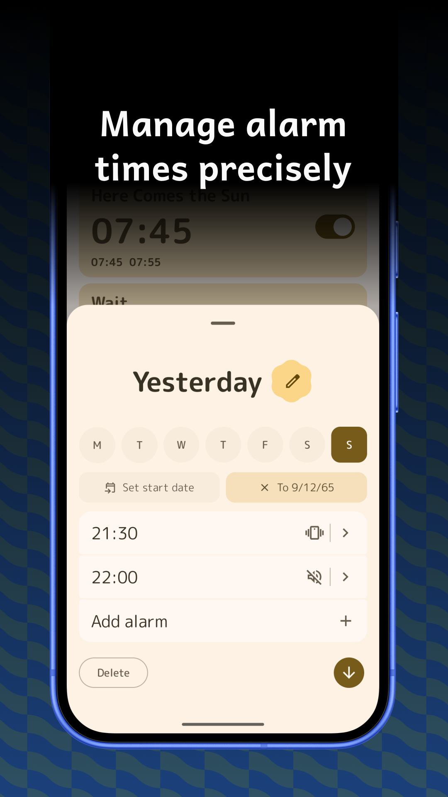
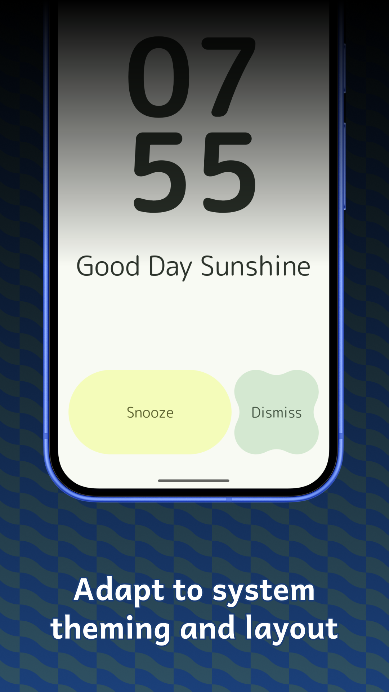

# Alarm Plus

Set alarms to trigger at specific times. Alarm Plus gives you more control over how when alarms are triggered.

Supports Android 7 to 16.

## Screenshots

|                                           |                               |                                   |                                |
|--------------------------------------------------:|:----------------------------------------------:|:----------------------------------------------:|:---------------------------------------------|
|  |  |  |  |

## Getting the App
Android (F-Droid)                            |	Android (Play Store)                            |	Android (Release Page)
-------------------------------------------------------:|:-------------------------------------------------------:|:-------------------------------------------------------
[](https://f-droid.org/packages/com.eden.alarmplus/) | [](https://play.google.com/store/apps/details?id=com.eden.alarmplus) | [Release Page](https://github.com/someone-s/alarm-plus/releases)

## Building From Source
Android Studio is the environment used for development, however, the app can also be built from the command line.

Gradle has to be installed.
```
gradlew :app:assembleRelease
```
